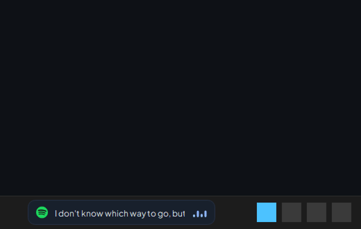
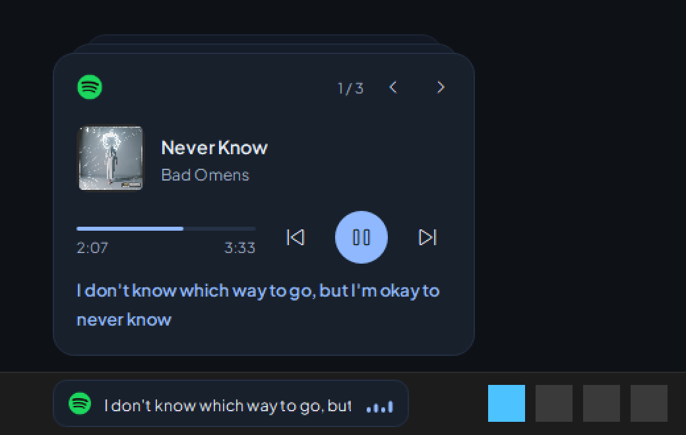
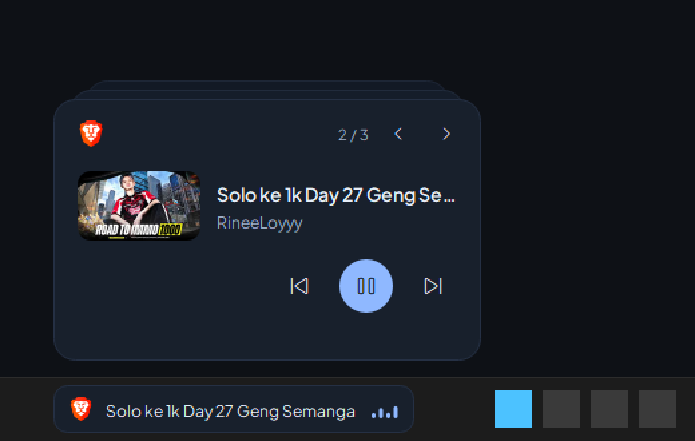
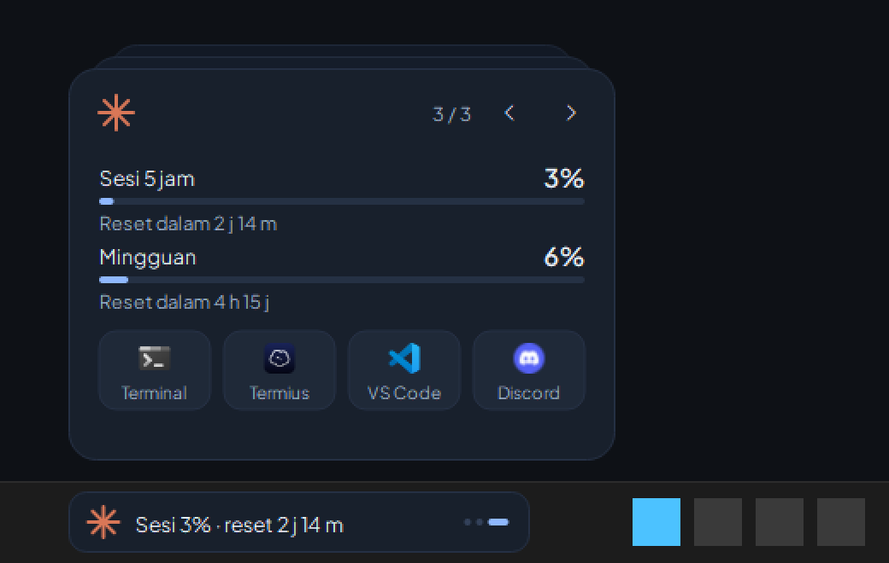
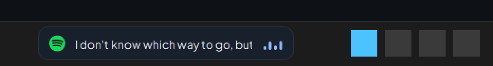

# Taskbar Island

A Dynamic Island–style widget that lives **inside the Windows 11 taskbar**. It shows what's playing on Spotify (with synced lyrics), what's playing on YouTube, and your Claude usage limits — as a stack of cards you can flip through.



| Spotify | YouTube | Claude |
|---|---|---|
|  |  |  |

In the taskbar it's a small pill next to the weather widget:



## Features

- **Spotify card**: cover, title, artist, progress, prev / play-pause / next.
  - **Synced lyrics** from [LRCLIB](https://lrclib.net). The current line also shows in the taskbar pill.
  - **Japanese lyrics are romanized** (kanji / kana → romaji) automatically.
- **YouTube card**: thumbnail, title, channel and playback controls for media playing in your browser.
- **Claude card**: 5-hour session and weekly usage with reset countdowns, plus launcher tiles (Terminal, Termius, VS Code, Discord — configurable).
- **Deck interactions**: hover the pill to open the deck. Flip cards with the ‹ › buttons or the mouse wheel. Cards slide away and the next one rises from the stack.
- **Click a card** to jump to its source: Spotify opens Spotify, YouTube brings the browser window forward, and Claude opens `claude.ai/settings/usage`.
- **Small details**: an equalizer animates while something is playing, long text scrolls like a marquee, and a newly started song or video jumps to the front.
- **Stays out of the way**: hides during fullscreen games and videos, and respects Windows' *Animation effects* setting.

## Requirements

- Windows 11
- Python 3.10+

## Install

```powershell
git clone https://github.com/xfwil/taskbar-island.git
cd taskbar-island
pip install -r requirements.txt
```

Run it without a console window:

```powershell
pythonw island.py
```

Right-click the pill → **Keluar** to quit.

Check the core logic (no GUI):

```powershell
python island.py --selftest
```

## Enable the Claude card

Claude Code sends your rate limits to its **status line** command as JSON on stdin. Taskbar Island reads a copy of that JSON from `~/.claude/island-status.json`.

Edit `~/.claude/settings.json`:

**If you already have a status line**, put `tee` in front of it so the JSON is copied and still passed through:

```jsonc
"statusLine": {
  "type": "command",
  "command": "tee ~/.claude/island-status.json | <your existing command>"
}
```

**If you don't have one**, just save the JSON:

```jsonc
"statusLine": {
  "type": "command",
  "command": "cat > ~/.claude/island-status.json"
}
```

The numbers refresh whenever Claude Code updates its status line, which happens while you're using it.

## Start automatically with Windows

Run this once from the repo folder. It creates a shortcut in your Startup folder:

```powershell
$lnk = (New-Object -ComObject WScript.Shell).CreateShortcut("$env:APPDATA\Microsoft\Windows\Start Menu\Programs\Startup\Taskbar Island.lnk")
$lnk.TargetPath = (Get-Command pythonw).Source
$lnk.Arguments = "`"$PWD\island.py`""
$lnk.WorkingDirectory = "$PWD"
$lnk.Save()
```

To turn it off, delete the shortcut:

```powershell
Remove-Item "$env:APPDATA\Microsoft\Windows\Start Menu\Programs\Startup\Taskbar Island.lnk"
```

## Configuration

Everything is at the top of `island.py`:

| Setting | What it does |
|---|---|
| `X_OFFSET` | Distance from the left edge of the screen. Increase it if the pill overlaps the weather widget. |
| `APP_ICONS` | Executables used for the card icons. Change the YouTube one if you use Chrome, Edge, etc. |
| `LAUNCHERS` | Launcher tiles on the Claude card: `(label, Start menu AppID, icon file)`. |
| `C` | Colors (Mist Blue theme). |
| `FONT` | UI font. Plus Jakarta Sans is bundled in `fonts/`. |

Find an app's Start menu AppID for `LAUNCHERS`:

```powershell
Get-StartApps | Where-Object Name -match "Telegram"
```

For Microsoft Store apps, set the icon to `appx:<PackageName>|<exe>`, e.g. `appx:Microsoft.WindowsTerminal|WindowsTerminal.exe`.

## How it works

- **Media**: Windows' `GlobalSystemMediaTransportControlsSessionManager` (via [PyWinRT](https://github.com/pywinrt/pywinrt)) provides title, artist, thumbnail, timeline and controls for Spotify and browsers. No Spotify or YouTube API keys are needed.
- **Lyrics**: [LRCLIB](https://lrclib.net) `get` (exact match by artist, title and duration), falling back to `search`. Romaji comes from [pykakasi](https://codeberg.org/miurahr/pykakasi).
- **Claude usage**: the `rate_limits.five_hour` / `seven_day` fields from Claude Code's status line JSON.
- **Taskbar placement**: Windows 11 has no API for taskbar widgets, so the pill is a frameless, always-on-top window placed over the taskbar.

## Known limitations

- All browser media is treated as YouTube.
- The YouTube card can't pick a specific browser tab. Clicking it brings forward the browser window whose title matches the video.
- Brave and some other browsers don't report video duration, so the YouTube progress bar may be hidden.
- Not every song has synced lyrics on LRCLIB, and romaji word splitting isn't always perfect.
- The equalizer is decorative; it doesn't react to the actual audio.
- Assumes the taskbar is at the bottom of the primary screen.

## Credits

- Font: [Plus Jakarta Sans](https://github.com/tokotype/PlusJakartaSans) by Tokotype, under the SIL Open Font License (`fonts/OFL.txt`).
- Lyrics: [LRCLIB](https://lrclib.net).
